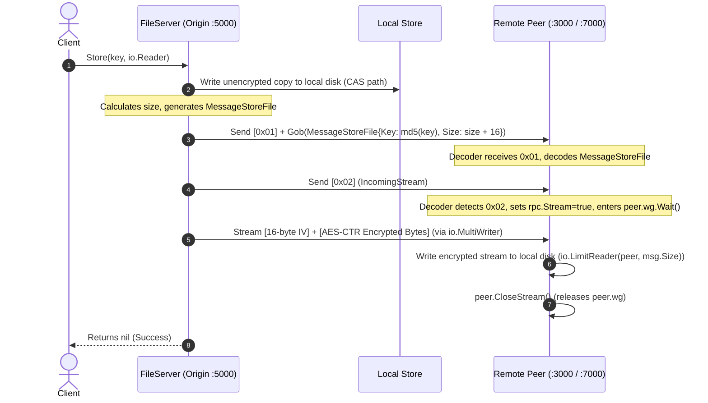
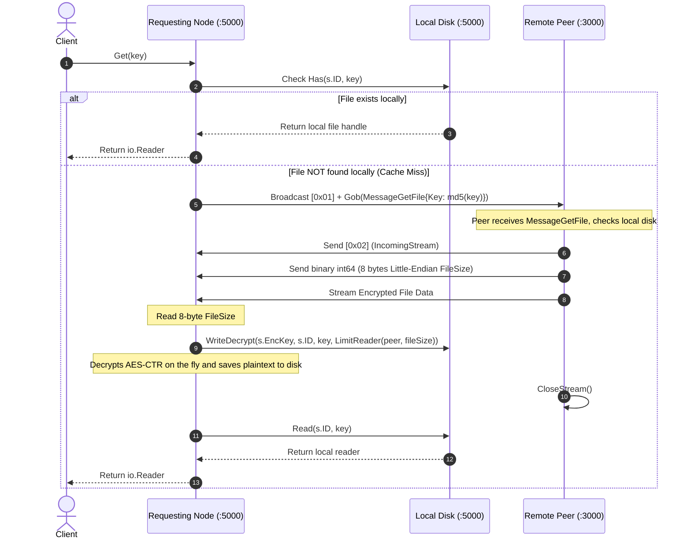

# Distributed File System (Go) — System Reference & Architecture Specification

## 1. Executive Summary & Overview

This project implements a decentralized, peer-to-peer (P2P), content-addressable distributed file system in Go (inspired by IPFS and BitTorrent mechanisms). It provides distributed file storage, secure stream-based replication across independent network nodes, symmetric AES-256 CTR encryption at rest/in-transit over TCP, and content-addressable path transformation (CAS) to optimize disk I/O and prevent filesystem inode saturation.

---

## 2. High-Level System Architecture

The system consists of three primary layered abstractions:

```
+-------------------------------------------------------------------+
|                           FileServer                              |
|   (Coordination, Peer Management, RPC Dispatch, Encrypt/Decrypt)  |
+---------------------------------+---------------------------------+
                                  |
         +------------------------+------------------------+
         |                                                 |
         v                                                 v
+-------------------------------+       +----------------------------------+
|           P2P Layer           |       |          Storage Layer           |
| (Transport, TCPPeer, Streams) |       | (Store, CAS Path Sharding, Disk) |
+-------------------------------+       +----------------------------------+
```

### Component Breakdown

1. **`FileServer` (`server.go`)**:
   - Core orchestrator tying together networking, disk persistence, and cryptographic operations.
   - Manages active peer map (`map[string]p2p.Peer`) protected by `sync.Mutex`.
   - Dispatches RPC messages arriving on the transport's consume channel (`<-chan RPC`).
   - Handles file replication broadcasting and distributed fetching.

2. **`P2P / Transport Layer` (`p2p/`)**:
   - `Transport` interface (`p2p/transport.go`): Abstracts transport implementations (Dial, ListenAndAccept, Consume, Close).
   - `TCPTransport` (`p2p/tcp_transport.go`): Manages TCP socket listeners, outbound dials, and connection loops.
   - `TCPPeer` (`p2p/tcp_transport.go`): Wraps `net.Conn`, handles binary stream control via a `sync.WaitGroup` to seamlessly switch between discrete RPC messages and raw bulk byte streams.
   - `Decoder` (`p2p/encoding.go`): Decodes frames from the wire, dynamically switching between discrete RPC payloads and stream indicators.

3. **`Storage Layer` (`store.go`)**:
   - `Store`: Abstraction for local disk storage rooted at a configurable folder path.
   - `PathTransformFunc` / `CASPathTransformFunc`: Transforms arbitrary file keys into Content-Addressable Storage (CAS) paths using SHA-1 hashing, splitting the hash into 5-character block directory prefixes.
   - Handles disk read, write, streaming, and directory teardown.

4. **`Cryptographic Subsystem` (`crypto.go`)**:
   - Generates random 32-byte node identifiers (`generateID()`).
   - Generates 256-bit symmetric encryption keys (`newEncryptionKey()`).
   - AES-256 CTR streaming encryption (`copyEncrypt`) and decryption (`copyDecrypt`) using a cryptographically random 16-byte Initialization Vector (IV) prepended to the data payload.

---

## 3. Network Protocol & Wire Specification

Communication between peers happens over persistent TCP connections multiplexed between **Discrete Messages** and **Raw Data Streams**.

### 3.1 Wire Protocol Framing

Every transmission on the TCP stream begins with a 1-byte command prefix:

| Prefix Byte | Constant Name | Type | Description |
|---|---|---|---|
| `0x01` | `IncomingMessage` | Control / RPC | Followed by Gob-encoded `Message` struct |
| `0x02` | `IncomingStream` | Bulk Data Stream | Direct binary stream (locks peer read-loop using `peer.wg`) |

### 3.2 RPC Message Payloads (`Message`)

The RPC layer uses Go's `encoding/gob` to serialize envelopes with dynamic payloads:

```go
type Message struct {
    Payload any
}
```

Registered payloads:
- **`MessageStoreFile`**:
  ```go
  type MessageStoreFile struct {
      ID   string // Sender Node ID
      Key  string // MD5 hash of target key
      Size int64  // Ciphertext byte length (Payload size + 16-byte IV)
  }
  ```
- **`MessageGetFile`**:
  ```go
  type MessageGetFile struct {
      ID  string // Requesting Node ID
      Key string // MD5 hash of requested file key
  }
  ```

### 3.3 Stream Protocol Formats

#### When Broadcasting / Replicating (`Store`):
```
[0x02 (1 Byte)] [16-Byte AES IV] [AES-256 CTR Encrypted File Data (N Bytes)]
```

#### When Serving Remote File Requests (`handleMessageGetFile`):
```
[0x02 (1 Byte)] [File Size (int64, 8 Bytes Little-Endian)] [Encrypted File Stream (N Bytes)]
```

---

## 4. End-to-End Data Flow

### 4.1 File Ingestion & Replication (`Store`)



### 4.2 Distributed File Retrieval (`Get`)



---

## 5. Storage Schema & Disk Layout

The project uses **Content-Addressable Storage (CAS)** with deterministic directory sharding.

### 5.1 CAS Path Transformation Algorithm (`CASPathTransformFunc`)
1. Compute SHA-1 sum of the key string: $H = \text{SHA1}(key)$ (40 hex characters).
2. Slice hex string into chunks of 5 characters:
   $$\text{Slice count} = \frac{40}{5} = 8\text{ directory levels}$$
3. Join slices with directory separator `/` to build `PathName`.
4. Resulting file path is: `<Root>/<NodeID>/<PathName>/<Filename>` where `Filename` is the full 40-character SHA-1 string.

### 5.2 Directory Layout Tree Example

```
3000_network/                                                          <-- StorageRoot (port_network)
└── 8b4ea40002262011679766097c4a05a7c2f27aea9b098cc9d7c1f11b31e5acbc/ <-- Node ID (32-byte hex)
    └── 5a740/                                                        <-- Block 0 (5 chars)
        └── f3c48/                                                    <-- Block 1 (5 chars)
            └── 2e4dd/                                                <-- Block 2 (5 chars)
                └── aa7c6/                                            <-- Block 3 (5 chars)
                    └── 53a98/                                        <-- Block 4 (5 chars)
                        └── a4eff/                                    <-- Block 5 (5 chars)
                            └── 90354/                                <-- Block 6 (5 chars)
                                └── f6b97/                            <-- Block 7 (5 chars)
                                    └── 5a740f3c482e4ddaa7c653...     <-- Full 40-char SHA1 File
```

### Why Directory Sharding?
Standard operating system filesystems (e.g. ext4, NTFS) suffer performance degradation when a single directory contains tens or hundreds of thousands of files. Splitting keys across hierarchical 5-character buckets bounds the maximum inode count per directory and provides fast lookups.

---

## 6. Security & Cryptographic Schema

```
+-----------------------------------------------------------------------+
| Plaintext Stream                                                      |
+-----------------------------------------------------------------------+
                                  |
                                  v
+------------------+     +-------------------+
| 256-bit Key      | --> | AES-256 CTR Mode  | <--- 16-Byte Cryptographic IV
+------------------+     +-------------------+      (crypto/rand)
                                  |
                                  v
+-----------------------------------------------------------------------+
| Wire Payload: [16-Byte IV] + [AES-CTR Encrypted Stream Ciphertext]    |
+-----------------------------------------------------------------------+
```

- **Symmetric Cipher**: AES (Advanced Encryption Standard) in **CTR** (Counter) Mode (`crypto/cipher.NewCTR`).
- **Initialization Vector (IV)**: 16 cryptographically secure random bytes generated via `crypto/rand` per stream.
- **Key Generation**: 32 bytes (256 bits) random key per node instance.
- **On-the-fly Streaming**: Employs `io.Reader` and `io.Writer` wrapping (`cipher.Stream.XORKeyStream`) in 32KB buffer chunks, requiring minimal memory footprint even for gigabyte-scale files.

---

## 7. Codebase Inventory & Map

| File Path | Primary Responsibilities |
|---|---|
| [`main.go`](file:///c:/Users/PRITHVI/Downloads/distributedfilesystemgo-master/distributedfilesystemgo-master/main.go) | Bootstrap cluster demonstration (creates 3 nodes `:3000`, `:7000`, `:5000`, writes, deletes, and distributed-fetches files) |
| [`server.go`](file:///c:/Users/PRITHVI/Downloads/distributedfilesystemgo-master/distributedfilesystemgo-master/server.go) | `FileServer` logic, network broadcast, remote message routing (`handleMessageGetFile`, `handleMessageStoreFile`), peer registry |
| [`store.go`](file:///c:/Users/PRITHVI/Downloads/distributedfilesystemgo-master/distributedfilesystemgo-master/store.go) | `Store`, CAS path generation, file creation, deletion, streaming disk reads/writes |
| [`crypto.go`](file:///c:/Users/PRITHVI/Downloads/distributedfilesystemgo-master/distributedfilesystemgo-master/crypto.go) | AES-256 CTR stream encryption/decryption, MD5 key hashing, ID generation |
| [`p2p/transport.go`](file:///c:/Users/PRITHVI/Downloads/distributedfilesystemgo-master/distributedfilesystemgo-master/p2p/transport.go) | `Transport` and `Peer` interface contracts |
| [`p2p/tcp_transport.go`](file:///c:/Users/PRITHVI/Downloads/distributedfilesystemgo-master/distributedfilesystemgo-master/p2p/tcp_transport.go) | TCP transport implementation, accept loop, connection handler, read loop, stream synchronization |
| [`p2p/message.go`](file:///c:/Users/PRITHVI/Downloads/distributedfilesystemgo-master/distributedfilesystemgo-master/p2p/message.go) | RPC container type and transport frame control byte constants (`0x1`, `0x2`) |
| [`p2p/encoding.go`](file:///c:/Users/PRITHVI/Downloads/distributedfilesystemgo-master/distributedfilesystemgo-master/p2p/encoding.go) | Frame decoder checking for `IncomingStream` vs `IncomingMessage` |
| [`p2p/handshake.go`](file:///c:/Users/PRITHVI/Downloads/distributedfilesystemgo-master/distributedfilesystemgo-master/p2p/handshake.go) | Node handshake interface (`HandshakeFunc`, `NOPHandshakeFunc`) |

---

## 8. Known Issues, Edge Cases & Platform Gotchas

1. **Windows File Locking (`unlinkat` / `ERROR_SHARING_VIOLATION`)**:
   - `s.Read(id, key)` returns an `*os.File` implementing `io.ReadCloser`.
   - On Windows, attempting `s.Delete(id, key)` or `s.Clear()` while an `*os.File` handle is still open will fail with:
     ```
     The process cannot access the file because it is being used by another process.
     ```
   - In [`store_test.go`](file:///c:/Users/PRITHVI/Downloads/distributedfilesystemgo-master/distributedfilesystemgo-master/store_test.go#L41-L50), `r` must be closed (`r.(io.Closer).Close()`) before calling `s.Delete()`.

2. **Network Synchronization Timers**:
   - The server relies on hard-coded `time.Sleep()` intervals (e.g., 5ms in `Store`, 500ms in `Get`) to allow peers to switch transport states between discrete RPC metadata and raw stream reading. A production design would use explicit handshake/ACK frames instead of arbitrary sleeps.

3. **Key Hashing Asymmetry**:
   - Local storage uses `CASPathTransformFunc(key)` (SHA-1 over `key`).
   - Network transmission hashes the key using `hashKey(key)` (MD5 over `key`) before sending in `MessageStoreFile` and `MessageGetFile`. Nodes receiving the remote message store the file under SHA-1 of the MD5 hash.

---

## 9. Build, Test & Execution Commands

### Run Tests
```powershell
go test -v ./...
```

### Build Binary
```powershell
go build -o bin/fs.exe
```

### Run Demonstration Cluster
```powershell
go run main.go server.go store.go crypto.go
```

